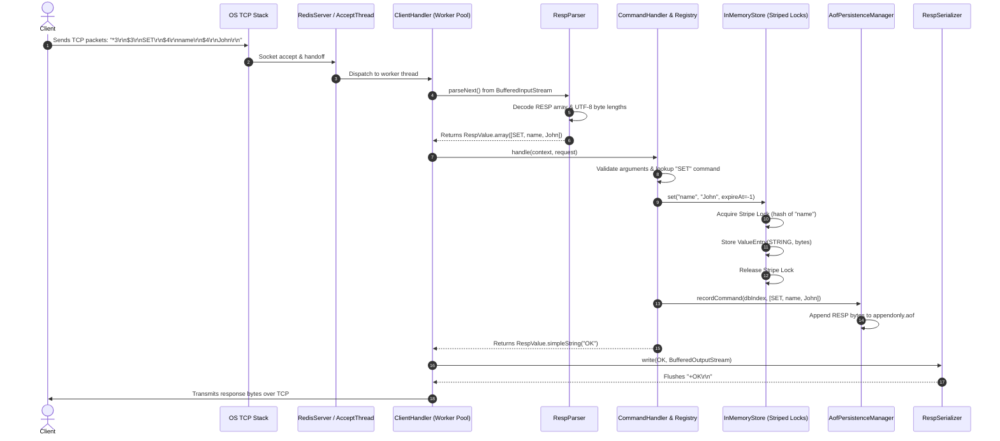

# Redis Internals Learning Guide: The Complete Request Lifecycle

This guide walks you through the step-by-step journey of a Redis command from the moment raw bytes arrive across a TCP network socket to parsing, command dispatching, thread-safe memory storage, persistence logging, and response transmission.

---

## 1. The High-Level Lifecycle



---

## 2. Stage-by-Stage Breakdown

### Stage 1: TCP Networking & Bounded Threading
1. **The Server Socket**:
   `RedisServer` creates a `ServerSocket` bound to `127.0.0.1:6379`. An `acceptThread` continuously blocks on `serverSocket.accept()`.
2. **Worker Pool Handoff**:
   When a client connects, instead of creating an unbounded `new Thread()`, the server submits a `ClientHandler` task to a bounded `ThreadPoolExecutor`.
   - If 1000 clients connect at once, the queue buffers tasks, preventing thread exhaustion or out-of-memory crashes.
3. **Socket Configuration**:
   - `TCP_NODELAY` is enabled to disable Nagle's algorithm. This ensures small RESP command packets are transmitted immediately without artificial 40ms delays.
   - Sockets are wrapped in `BufferedInputStream` and `BufferedOutputStream` (16KB buffers) to minimize expensive system calls (`read()` and `write()`).

---

### Stage 2: RESP2 Protocol Parsing
Redis commands are encoded in RESP2 (REdis Serialization Protocol). Let's trace how the parser decodes `SET name John`:

```
*3\r\n$3\r\nSET\r\n$4\r\nname\r\n$4\r\nJohn\r\n
```

1. **Prefix Identification**:
   - The first byte is read: `*`.
   - The parser knows this is an **Array**.
2. **Count Header**:
   - Reads the integer line until `\r\n`: `3`.
   - It now allocates an array of size 3 and recursively parses 3 child elements.
3. **Bulk String Elements**:
   - Element 0: Reads `$3\r\n`. Allocates a 3-byte array, reads exactly 3 bytes (`S`, `E`, `T`), and verifies the trailing `\r\n`.
   - Element 1: Reads `$4\r\n`. Reads 4 bytes (`n`, `a`, `m`, `e`) and verifies `\r\n`.
   - Element 2: Reads `$4\r\n`. Reads 4 bytes (`J`, `o`, `h`, `n`) and verifies `\r\n`.
4. **Safety Limits**:
   - The parser checks `MAX_BULK_LENGTH` (64 MB) and `MAX_LINE_LENGTH` (64 KB). If an attacker sends `$99999999999\r\n`, the parser aborts before allocating huge byte buffers, safeguarding server memory.
5. **Inline Fallback**:
   - If the first character is not `*`, `+`, `-`, `:`, or `$`, the parser automatically switches to **Inline Mode**, splitting the line by whitespace. This is why you can type `PING` or `SET k v` in PowerShell or Telnet without raw RESP prefixes!

---

### Stage 3: Command Routing & Context
1. **The Request Object**:
   The parser returns a `RespValue` containing an array of 3 bulk strings.
2. **Command Context**:
   Each client maintains a `CommandContext` tracking:
   - Selected logical database (default DB 0, changeable via `SELECT 1`).
   - Connection lifetime and command count metrics.
   - Client name (set by `CLIENT SETNAME`).
   - Persistence manager reference.
3. **Registry Lookup**:
   `CommandHandler` extracts token 0 (`SET`), converts it to uppercase, and queries `CommandRegistry`.
4. **Validation**:
   The command handler ensures correct argument counts (`SET` requires at least 2 arguments: `key` and `value`). If invalid, it returns `-ERR wrong number of arguments for 'set' command\r\n`.

---

### Stage 4: Storage Engine & Concurrency
How does `InMemoryStore` store keys without race conditions or deadlocks?

1. **Striped Locking**:
   - Instead of locking the entire database (which blocks all clients) or locking individual entries in an unbounded lock map (which leaks memory), the store uses **256 striped `ReentrantLock` instances**.
   - The stripe index is calculated via hash spreading:
     ```java
     int stripe = (key.hashCode() ^ (key.hashCode() >>> 16)) & 255;
     ```
   - Two clients mutating `user:1` and `product:99` acquire different locks and run in parallel at full speed!
2. **Type Safety**:
   - Values are stored in `ValueEntry(RedisType type, Object data, long expireAtEpochMs)`.
   - If a client runs `LPUSH` on a key that currently holds a `STRING`, `checkAndGet(key)` detects the type mismatch and throws `WrongTypeException`.
   - The handler intercepts this and returns `-WRONGTYPE Operation against a key holding the wrong kind of value\r\n`.
3. **Lazy Expiration**:
   - Every lookup checks `entry.hasExpired(clock)`.
   - If the current time exceeds `expireAtEpochMs`, the entry is pruned from memory on the spot, and `null` is returned.
4. **Active Sweeping**:
   - A background daemon thread periodically samples 20 keys per database every 100ms. If any are expired, they are evicted so abandoned keys don't consume RAM.

---

### Stage 5: Persistence Logging (AOF)
If disk persistence is enabled:
1. When a write command succeeds (e.g., `SET`, `INCR`, `RPUSH`, `HDEL`), the `CommandHandler` calls `persistenceManager.recordCommand(dbIndex, command)`.
2. If the current DB index changed since the last logged command, an automatic `SELECT <dbIndex>` command is prepended to the AOF.
3. The command is serialized as standard RESP bytes and written to `data/appendonly.aof`.
4. **Startup Recovery**:
   On server startup, `AofPersistenceManager.recover()` streams commands from the file using `RespParser` and executes them in order, rebuilding the entire database in memory. If a trailing command was cut short due to a sudden crash, the parser safely stops at the last intact record without corrupting the file or failing the server!

---

### Stage 6: Response Serialization
1. The command execution yields a `RespValue.simpleString("OK")`.
2. `RespSerializer.write(value, socketOutputStream)` translates the typed object into the wire format:
   ```
   +OK\r\n
   ```
3. The stream is flushed, and the client receives the answer.
