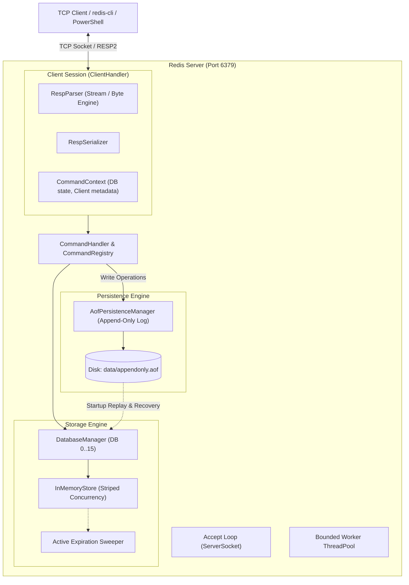

# Redis-Compatible Server in Java

A high-performance, modular, Redis-compatible in-memory data store written from scratch in modern Java (Java 21 LTS). It implements the Redis Serialization Protocol (RESP2), non-blocking TCP socket communication, in-memory data structures, key expiration, Append-Only File (AOF) persistence with crash tolerance, and concurrency control.

---

## Architecture Overview



---

## Package and Component Responsibilities

| Package | Key Classes | Responsibility |
|---|---|---|
| [`redis`](file:///c:/Users/Lenovo/OneDrive/Desktop/Redis%20Server/src/main/java/redis/Main.java) | `Main` | Entry point, CLI argument parsing (`--port`, `--dir`, `--threads`), banner display, and shutdown handling. |
| [`redis.server`](file:///c:/Users/Lenovo/OneDrive/Desktop/Redis%20Server/src/main/java/redis/server/RedisServer.java) | `RedisServer`, `ClientHandler` | TCP `ServerSocket` accept loop, bounded thread pool execution, connection lifecycle, and graceful shutdown. |
| [`redis.protocol`](file:///c:/Users/Lenovo/OneDrive/Desktop/Redis%20Server/src/main/java/redis/protocol/RespParser.java) | `RespValue`, `RespType`, `RespParser`, `RespSerializer` | Zero-copy byte manipulation, RESP2 parsing/serialization, CRLF handling, UTF-8 safety, inline command support. |
| [`redis.storage`](file:///c:/Users/Lenovo/OneDrive/Desktop/Redis%20Server/src/main/java/redis/storage/InMemoryStore.java) | `Store`, `InMemoryStore`, `ValueEntry`, `DatabaseManager`, `WrongTypeException` | Striped concurrency-safe in-memory key-value maps, TTL management, active background expiration, logical database routing. |
| [`redis.command`](file:///c:/Users/Lenovo/OneDrive/Desktop/Redis%20Server/src/main/java/redis/command/CommandRegistry.java) | `Command`, `CommandRegistry`, `CommandHandler`, `CommandContext` | Command dispatch table, argument count/type validation, persistence trigger on writes, error formatting. |
| [`redis.command.impl`](file:///c:/Users/Lenovo/OneDrive/Desktop/Redis%20Server/src/main/java/redis/command/impl/StringCommands.java) | `StringCommands`, `KeyCommands`, `ListCommands`, `SetCommands`, `HashCommands`, `ServerCommands` | Implementations of Redis commands according to official Redis specification. |
| [`redis.persistence`](file:///c:/Users/Lenovo/OneDrive/Desktop/Redis%20Server/src/main/java/redis/persistence/AofPersistenceManager.java) | `PersistenceManager`, `AofPersistenceManager` | Append-Only File (AOF) logging of write commands, startup recovery with safe truncation of corrupted/incomplete trailing writes. |
| [`redis.config`](file:///c:/Users/Lenovo/OneDrive/Desktop/Redis%20Server/src/main/java/redis/config/ServerConfig.java) | `ServerConfig` | Configuration settings for network host/port, storage paths, persistence, and thread pools. |
| [`redis.util`](file:///c:/Users/Lenovo/OneDrive/Desktop/Redis%20Server/src/main/java/redis/util/ByteArrayKey.java) | `ByteArrayKey`, `Clock` | Immutable byte-array wrapper for Map/Set hashing and deterministic clock interface for reproducible expiration testing. |

---

## Deep Dive: How the Server Works Internally

### 1. TCP Sockets and Concurrency
* **Bounded Concurrency**: Unlike naive servers that spawn an unbounded thread per client, `RedisServer` utilizes a bounded `ThreadPoolExecutor` (default 16 workers, configurable via `-t`).
* **Connection Lifecycle**: `RedisServer` runs an accept loop on a background thread. Incoming TCP connections are assigned a `ClientHandler`. 
* **Resource Protection**: Sockets configure `TCP_NODELAY` to minimize command latency and enable keep-alive. Disconnections, EOFs, or network resets are caught safely and do not terminate the server process.

### 2. RESP2 Protocol Engine
The server communicates via standard Redis Serialization Protocol 2 (RESP2):
* `+` **Simple String**: Single-line strings without binary characters (`+OK\r\n`).
* `-` **Error**: Standard error line (`-ERR unknown command 'x'\r\n`, `-WRONGTYPE ...`).
* `:` **Integer**: 64-bit signed ASCII integers (`:1000\r\n`).
* `$` **Bulk String**: Binary-safe byte payloads prefixed with byte length (`$5\r\nhello\r\n` or `$-1\r\n` for Nil).
* `*` **Array**: Lists of RESP elements (`*2\r\n$4\r\nECHO\r\n$2\r\nHI\r\n`).
* **Inline Commands**: The parser automatically recognizes non-prefixed text commands (e.g. `PING\r\n` or `SET key value\r\n`), making manual testing with PowerShell, telnet, or netcat trivial.

### 3. Data Storage & Concurrency Control
* **Atomic Multi-operation Execution**: Using 256 striped `ReentrantLock` partitions, operations on keys in different stripes run completely in parallel, while compound mutations on the same key (such as `INCRBY`, `LPUSH`, `HSET`) execute with strict serial consistency.
* **Multi-key Deadlock Freedom**: Commands operating on multiple keys (`MSET`, `MGET`, `DEL`) sort keys deterministically before acquiring locks, preventing circular wait deadlocks.
* **Type Safety**: Keys store a `ValueEntry` containing `RedisType`. Incompatible operations raise a `WrongTypeException` returning Redis's standard error response.

### 4. Expiration Mechanics
* **Passive (Lazy) Expiration**: Whenever a key is accessed (read or write), its expiration timestamp is checked against the server clock. If expired, it is immediately pruned and treated as non-existent.
* **Active (Eager) Expiration**: A background daemon thread sweeps random keys across databases every 100ms (`activeExpireCycle`), ensuring keys that are never accessed again do not linger in memory.

### 5. Persistence & Recovery (AOF)
* **Append-Only File Logging**: Write commands that mutate data (`SET`, `DEL`, `INCR`, `LPUSH`, `HSET`, etc.) are serialized in RESP format and written to `data/appendonly.aof`. When commands change databases, a `SELECT <db>` record is prepended.
* **Crash-Tolerant Replay**: On server startup, the file is replayed through the command pipeline into an empty database.
* **Tolerant of Trailing Corruption**: If a power outage or crash occurs mid-write, the server detects incomplete trailing bytes at the end of the file, recovers all intact preceding commands, logs a warning with the exact offset, and continues operating without failing startup or corrupting existing data.

---

## Supported Commands

| Category | Commands Supported |
|---|---|
| **Basic & Strings** | `PING`, `ECHO`, `SET` (with `EX` / `PX`), `GET`, `DEL`, `EXISTS`, `TYPE`, `INCR`, `DECR`, `INCRBY`, `DECRBY`, `MGET`, `MSET`, `APPEND`, `STRLEN`, `KEYS` (glob pattern matching `*`, `?`, `[abc]`), `DBSIZE`, `FLUSHDB` |
| **Key Expiration** | `EXPIRE`, `PEXPIRE`, `TTL`, `PTTL`, `PERSIST`, `SET ... EX/PX` |
| **Lists** | `LPUSH`, `RPUSH`, `LPOP`, `RPOP`, `LLEN`, `LRANGE` (supports negative indices `-1`) |
| **Sets** | `SADD`, `SREM`, `SISMEMBER`, `SMEMBERS`, `SCARD` |
| **Hashes** | `HSET`, `HGET`, `HDEL`, `HEXISTS`, `HGETALL`, `HLEN` |
| **Server & Connection** | `QUIT`, `SELECT` (0 to 15), `COMMAND`, `CLIENT SETNAME`, `CLIENT GETNAME`, `INFO` |

---

## Build and Run Instructions (Windows 11)

### Prerequisites
* **Java 21** or later (`java -version`)
* **Maven 3.8+** (`mvn -version`)

### 1. Build and Run Tests
```powershell
mvn test
```

### 2. Package Runnable JAR
```powershell
mvn package -DskipTests
```
The compiled jar will be at `target/redis-server-1.0.0.jar`.

### 3. Start the Redis Server
```powershell
java -jar target/redis-server-1.0.0.jar --port 6379 --dir ./data
```

CLI Options:
* `-p, --port <port>`: Port to listen on (default: `6379`)
* `-h, --host <host>`: Bind host address (default: `127.0.0.1`)
* `-t, --threads <num>`: Worker thread pool size (default: `16`)
* `-d, --dir <path>`: Directory where `appendonly.aof` is saved (default: `./data`)
* `--aof <true|false>`: Enable or disable disk persistence (default: `true`)

---

## Connecting and Testing with Windows PowerShell

You do not need `redis-cli` installed. You can interact with the server directly in PowerShell using a raw TCP socket!

### PowerShell TCP Client Function
Open a new PowerShell window and paste this helper function:

```powershell
function Send-RedisCommand {
    param(
        [string]$Command = "PING",
        [string]$Host = "127.0.0.1",
        [int]$Port = 6379
    )
    $client = New-Object System.Net.Sockets.TcpClient($Host, $Port)
    $stream = $client.GetStream()
    $writer = New-Object System.IO.StreamWriter($stream, [System.Text.Encoding]::UTF8)
    $reader = New-Object System.IO.StreamReader($stream, [System.Text.Encoding]::UTF8)
    $writer.AutoFlush = $true

    $writer.Write("$Command`r`n")
    Start-Sleep -Milliseconds 50

    $response = ""
    while ($stream.DataAvailable) {
        $response += $reader.ReadLine() + "`n"
    }

    $client.Close()
    return $response.Trim()
}
```

### Examples

#### 1. Basic Commands
```powershell
Send-RedisCommand "PING"
# Output: +PONG

Send-RedisCommand "ECHO 'Hello Windows!'"
# Output: Hello Windows!

Send-RedisCommand "SET message 'Redis in Java'"
# Output: +OK

Send-RedisCommand "GET message"
# Output: Redis in Java
```

#### 2. Integer Counters
```powershell
Send-RedisCommand "INCR counter"
# Output: :1

Send-RedisCommand "INCRBY counter 25"
# Output: :26
```

#### 3. Lists
```powershell
Send-RedisCommand "RPUSH tasks job1 job2 job3"
# Output: :3

Send-RedisCommand "LRANGE tasks 0 -1"
# Output: job1 job2 job3
```

#### 4. Hashes
```powershell
Send-RedisCommand "HSET user:100 username Alice role admin"
# Output: :2

Send-RedisCommand "HGETALL user:100"
# Output: username Alice role admin
```

#### 5. Expiration
```powershell
Send-RedisCommand "SET tempKey 'bye soon' EX 5"
Send-RedisCommand "TTL tempKey"
# Output: :5
Start-Sleep -Seconds 6
Send-RedisCommand "GET tempKey"
# Output: $-1 (nil)
```

#### 6. Multi-Database (SELECT)
```powershell
Send-RedisCommand "SELECT 1"
# Output: +OK
```

#### 7. Graceful Disconnect
```powershell
Send-RedisCommand "QUIT"
# Output: +OK
```

---

## Known Limitations and Differences from Official Redis

| Feature | Official Redis | This Implementation |
|---|---|---|
| **Engine Architecture** | Single-threaded event loop (`ae` epoll/kqueue). | Multi-threaded with bounded thread pool and 256 striped key locks. |
| **Persistence format** | Binary RDB format and complex AOF with rewrite (`BGREWRITEAOF`). | RESP-based Append-Only File (AOF) with automatic replaying and corrupt tail record recovery. RDB snapshotting is not implemented. |
| **Replication & Clustering** | Full master-replica synchronization, Sentinel, and Cluster gossip. | Standalone single-node server. |
| **Pub/Sub & Transactions** | `SUBSCRIBE`, `PUBLISH`, `MULTI`, `EXEC`. | Focus is on core KV data structures, types, TTLs, and persistence. |
| **Scripting** | Embedded Lua engine / Redis Functions. | Not supported. |
