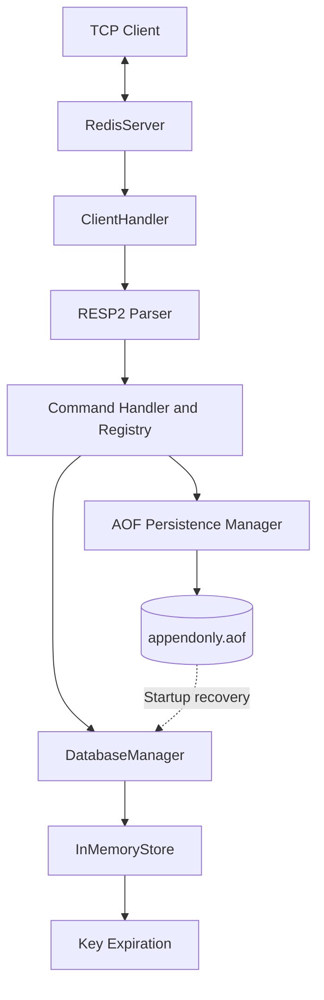

# Redis-Compatible Server in Java

A Redis-inspired in-memory data store built from scratch in Java 21. The project implements the RESP2 protocol, TCP client connections, common Redis-style data structures, key expiration, multiple logical databases, and Append-Only File (AOF) persistence with startup recovery.

> **Project status:** 30 automated tests passed in the latest test run. This is an educational implementation inspired by Redis, not a complete replacement for the official Redis server.

## Features

- **RESP2 protocol:** Parses and serializes common RESP2 values for client-server communication.
- **TCP server:** Accepts client connections on a configurable host and port.
- **Command handling:** Routes commands through a command registry and handler.
- **In-memory data structures:** Supports strings, lists, sets, and hashes.
- **Key expiration:** Supports TTL-based expiration with lazy and background expiration mechanisms.
- **Logical databases:** Supports database selection with `SELECT` for database indexes 0–15.
- **AOF persistence:** Records write commands and replays valid records during startup.
- **Recovery from incomplete trailing records:** Attempts to recover valid preceding commands when the AOF ends with a corrupt or incomplete record.
- **Automated tests:** Covers protocol parsing, command behavior, TCP integration, and persistence recovery.

## Architecture



## Technology Stack

- Java 21
- Maven
- TCP sockets
- RESP2 protocol
- JUnit 5

## Project Structure

| Package | Responsibility |
|---|---|
| `redis` | Application entry point and command-line arguments |
| `redis.server` | TCP server and client connection handling |
| `redis.protocol` | RESP2 parsing and serialization |
| `redis.command` | Command dispatch and execution context |
| `redis.command.impl` | String, key, list, set, hash, and server commands |
| `redis.storage` | In-memory storage, logical databases, and expiration |
| `redis.persistence` | AOF logging and startup recovery |
| `redis.config` | Server configuration |
| `redis.util` | Utility classes |

## Supported Commands

The implementation includes the following command families. Behavior may differ from official Redis for edge cases and advanced options.

| Category | Commands |
|---|---|
| Connection and server | `PING`, `ECHO`, `QUIT`, `INFO`, `COMMAND`, `CLIENT SETNAME`, `CLIENT GETNAME` |
| Strings and keys | `SET`, `GET`, `DEL`, `EXISTS`, `TYPE`, `INCR`, `DECR`, `INCRBY`, `DECRBY`, `MGET`, `MSET`, `APPEND`, `STRLEN`, `KEYS`, `DBSIZE`, `FLUSHDB` |
| Expiration | `EXPIRE`, `PEXPIRE`, `TTL`, `PTTL`, `PERSIST`, `SET` with `EX` or `PX` |
| Lists | `LPUSH`, `RPUSH`, `LPOP`, `RPOP`, `LLEN`, `LRANGE` |
| Sets | `SADD`, `SREM`, `SISMEMBER`, `SMEMBERS`, `SCARD` |
| Hashes | `HSET`, `HGET`, `HDEL`, `HEXISTS`, `HGETALL`, `HLEN` |
| Databases | `SELECT` |

## Prerequisites

Install the following:

- Java 21 or later
- Maven 3.8 or later

Check your installation:

```powershell
java -version
mvn -version
```

## Build and Test

Clone the repository:

```powershell
git clone https://github.com/jaisandeep842/REDIS-SERVER.git
cd REDIS-SERVER
```

Run the automated tests:

```powershell
mvn test
```

Package the executable JAR:

```powershell
mvn package
```

The JAR is created at:

```text
target/redis-server-1.0.0.jar
```

## Run the Server

Start the server from the project directory:

```powershell
java -jar .targetredis-server-1.0.0.jar --port 6379 --dir .data
```

The server uses port `6379` by default. The data directory stores `appendonly.aof` when AOF persistence is enabled.

Available command-line options:

| Option | Purpose |
|---|---|
| `-p`, `--port` | TCP port |
| `-h`, `--host` | Bind address |
| `-t`, `--threads` | Worker thread pool size |
| `-d`, `--dir` | Directory for AOF data |
| `--aof` | Enable or disable AOF persistence |

Use `java -jar .targetredis-server-1.0.0.jar --help` if help output is supported by your current build.

## Quick Test with PowerShell

With the server running, open a second PowerShell window and run:

```powershell
$client = [System.Net.Sockets.TcpClient]::new("127.0.0.1", 6379)
$stream = $client.GetStream()
$writer = [System.IO.StreamWriter]::new($stream, [System.Text.Encoding]::UTF8)
$reader = [System.IO.StreamReader]::new($stream, [System.Text.Encoding]::UTF8)

$writer.NewLine = "`r`n"
$writer.AutoFlush = $true

$writer.WriteLine("PING")
$response = $reader.ReadLine()
"PING response: $response"

$writer.WriteLine("SET greeting hello")
$response = $reader.ReadLine()
"SET response: $response"

$writer.WriteLine("GET greeting")
$header = $reader.ReadLine()
$value = $reader.ReadLine()
"GET header: $header"
"GET value: $value"

$client.Close()
```

Expected responses include:

```text
PING response: +PONG
SET response: +OK
GET header: $5
GET value: hello
```

RESP2 bulk-string replies contain a length header followed by the value and its terminating CRLF. This example reads the header and value separately.

## Persistence and Recovery

When AOF persistence is enabled, write commands are recorded in the AOF file. During startup, the server replays valid recorded commands to restore data.

To test recovery:

1. Start the server with an AOF data directory.
2. Connect and run `SET student Sandeep`.
3. Stop the server gracefully.
4. Start it again with the same data directory.
5. Run `GET student` and verify the recovered value.

Do not delete the AOF file if you want to preserve the stored data.

## Tests

The latest reported test run completed with:

```text
Tests run: 30, Failures: 0, Errors: 0, Skipped: 0
BUILD SUCCESS
```

Test coverage includes command behavior, protocol parsing and serialization, persistence recovery, and TCP server integration.

## Limitations

This project implements a subset of Redis behavior. It does not aim for complete Redis compatibility.

- No Redis Cluster or Sentinel.
- No master-replica replication.
- No Pub/Sub.
- No transaction support such as `MULTI` and `EXEC`.
- No Lua scripting or Redis Functions.
- No RDB snapshots or AOF rewrite equivalent to `BGREWRITEAOF`.
- Some command options, edge cases, and performance characteristics may differ from official Redis.

## Learning Goals

This project explores:

- TCP server programming in Java
- RESP2 protocol design
- Command dispatch and validation
- Threading and concurrent in-memory storage
- Expiration and logical database management
- Append-only persistence and recovery
- Unit and integration testing with JUnit

## Repository

[View the project on GitHub](https://github.com/jaisandeep842/REDIS-SERVER)
